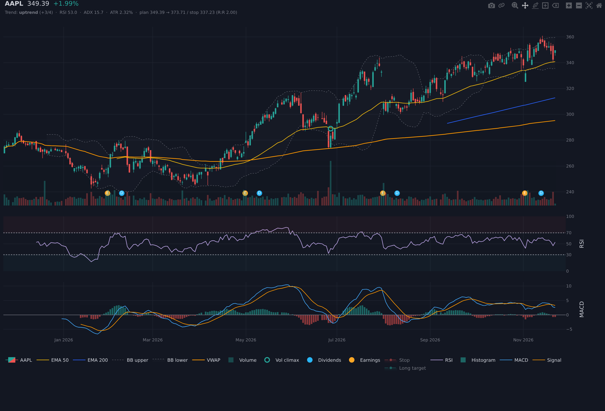

# tvchart

**TradingView-style technical charts and indicator analytics in Python — one command, one HTML file.**

`tvchart` takes the notebook approach most people start with (yfinance + pandas + Plotly)
and turns it into a small, tested library: indicators implemented with TradingView's own
conventions, a three-panel chart, a JSON summary you can feed to an LLM or a report, and a
multi-timeframe bias score.

```bash
tvchart AAPL -i 1d -p 1y --plan long --mtf -o aapl.html
```



---

## Why not just the notebook?

The original notebook works, but it has bugs that silently produce wrong numbers:

| Notebook | tvchart |
|---|---|
| RSI from a simple rolling mean | Wilder's RMA (`ta.rsi`), flat stretches → 50 |
| Bollinger bands with sample stdev | population stdev (`ta.stdev`, ddof=0) |
| VWAP cumulated over the whole history | session VWAP intraday, anchored VWAP on daily |
| `iloc[-1]` on an empty frame → `IndexError` | validated load, clear error message |
| Hard-coded `take_profit = 236` / `stop_loss = 193` | ATR + swing-structure plan per ticker |
| Earnings hover uses two `%{customdata}` fields in one format string | separate fields, correct tooltip |
| Re-downloads on every run, no cache | 15-minute disk cache |
| Chart only | chart + JSON + CSV + MTF bias |

It also fixes the layout problems: volume no longer covers the candles, the summary no
longer sits on top of the price action, and the HTML page background matches the theme.

## Install

```bash
git clone https://github.com/LoloMojo/Python-stock-charting.git
cd tvchart
python -m venv .venv && source .venv/bin/activate
pip install -e ".[dev]"
```

Python 3.10+. Dependencies: `pandas`, `numpy`, `yfinance`, `plotly`.

## CLI

```bash
tvchart NVDA -i 1d -p 6mo                       # dark chart, current dir
tvchart NVDA -i 15m -p 1mo --theme light        # intraday, light theme
tvchart NVDA -i 1wk -p 5y --plan long --mtf     # weekly + trade plan + MTF score
tvchart NVDA -i 1d --start 2024-01-01 --end 2025-01-01 --json nvda.json --csv nvda.csv
```

| Flag | Meaning |
|---|---|
| `-i/--interval` | `1m 5m 15m 30m 1h 1d 1wk 1mo` |
| `-p/--period` | `1mo 3mo 6mo 1y 2y 5y max` (or `--start/--end`) |
| `-o/--out` | HTML path (default `<TICKER>_<interval>.html`) |
| `--json PATH` | write the summary as JSON (`-` = stdout) |
| `--csv PATH` | write the enriched data |
| `--plan long\|short` | ATR-based stop/target overlay |
| `--mtf` | weekly/daily/1h/15m alignment score |
| `--theme dark\|light` | chart theme |
| `--no-cache` | bypass the 15-minute disk cache |

Terminal output example:

```
AAPL  last 349.39  (+1.99%)  [2026-11-23 00:00:00]
  trend      : uptrend (+3/4)
               - price above EMA50
               - EMA50 above EMA200 (golden structure)
               - MACD in transition (line and histogram disagree)
               - RSI 53.0 > 50
  support    : 347.93
  resistance : 349.76
  BB width   : 2.11% (pct 96.0 → expansion)
  EMA cross  : bullish 51 bars ago (2026-11-19)
  MACD cross : bullish 4 bars ago (2026-11-23)

  multi-timeframe alignment:
     1wk  uptrend            score +3  RSI 55.1
      1d  uptrend            score +3  RSI 53.0
      1h  mildly bullish     score +1  RSI 58.4
     15m  mildly bullish     score +1  RSI 62.4
    bias: bullish  (+0.56)
```

### Machine-readable output

`--json` takes a path; `-` streams to stdout so you can pipe it. The human-readable
summary goes to stderr in that mode, so stdout stays pure JSON:

```bash
tvchart AAPL -i 1d -p 6mo --plan long --json - -o aapl.html | jq '.trend, .plan'
tvchart AAPL -i 1d -p 6mo --json aapl.json --csv aapl.csv   # files instead
```

```python
import json, subprocess
out = subprocess.run(["tvchart", "AAPL", "--json", "-", "-o", "a.html"],
                     capture_output=True, text=True, check=True)
summary = json.loads(out.stdout)          # stderr holds the pretty report
```

### Batch scanning and history

`tvchart-scan` runs a watchlist through the same pipeline and appends every run to an
append-only JSONL history, so you can rank setups *and* track how they change over time.

```bash
tvchart-scan examples/watchlist.txt -i 1d -p 1y --mtf --plan long \
    --history scan_history.jsonl --csv scan_latest.csv
```

```
  12 scanned  ·  0 failed  ·  interval 1d
  ticker   score  trend   rsi   adx   atr%    bw%    mtf  tags
  AAPL      2.45      3  52.1  15.7   2.39   6.88   0.38  mtf-aligned-up,trend-up
  ...
```

Each row carries the trend score, RSI/ADX/ATR, Bollinger width and percentile, the ATR
trade plan, the MTF alignment, and `setup_score` — a documented composite (trend 2.0,
MTF 1.5, RSI 1.0, ADX 0.5, squeeze 0.5, extension penalty 0.5). On the second run the
same ticker gets `prev_run_utc`, `days_since_prev`, `trend_delta`, `rsi_delta` and
`close_delta_pct`, so the file becomes a time series rather than a snapshot.

The history is append-only by design: failures are recorded as rows with an `error`
field instead of aborting the batch, and nothing is ever rewritten.

```python
from tvchart import scan_watchlist
rows = scan_watchlist(["AAPL", "NVDA"], interval="1d", history_path="scan_history.jsonl")
print(rows[0]["setup_score"], rows[0]["tags"])
```

## Python API

```python
from tvchart import load, enrich, build_chart, save_html, summary, mtf_alignment

df, meta = load("AAPL", interval="1d", period="1y")
df = enrich(df)

print(summary(df, "AAPL")["trend"])
fig = build_chart(df, "AAPL", plan=None, theme="dark")
save_html(fig, "aapl.html")
```

Indicators are plain functions if you only want the numbers:

```python
from tvchart import rsi, bollinger, macd, atr, vwap

df["rsi"] = rsi(df["close"], 14)
bb = bollinger(df["close"], 20, 2.0)      # bb_mid, bb_upper, bb_lower
```

### Multi-timeframe bias

```python
frames = {}
for label, interval, period in [("1wk", "1wk", "2y"), ("1d", "1d", "1y"),
                                ("1h", "1h", "3mo"), ("15m", "15m", "1mo")]:
    d, _ = load("AAPL", interval=interval, period=period)
    frames[label] = enrich(d)

print(mtf_alignment(frames))
# {'bias': 'bullish', 'score': 0.56, 'timeframes': [...]}
```

The score is the weighted mean of each timeframe's trend score in `[-4, +4]`,
rescaled to `[-1, +1]`: `> 0.35` bullish, `< -0.35` bearish, otherwise mixed.

## Indicator conventions

| Indicator | Convention |
|---|---|
| EMA | seeded with first value, `adjust=False` (`ta.ema`) |
| RSI | Wilder RMA, alpha = 1/length; flat → 50 (`ta.rsi`) |
| Bollinger | 20-period SMA ± 2 × **population** stdev (`ta.bb`) |
| MACD | 12/26/9 EMA; histogram = MACD − signal (not doubled) |
| ATR | RMA of true range (`ta.atr`) |
| VWAP | session reset intraday; anchored from window start on daily |
| Stochastic | 14/3/3, %K smoothed with SMA |
| ADX | Wilder's smoothing, 14 |
| Donchian | 20-bar high/low channel |

Trend score: price vs EMA50, EMA50 vs EMA200, MACD line+histogram agreement,
RSI vs 50 → `-4..+4`.

## What this does *not* do

Being honest about the gap with TradingView:

- **No real-time data.** yfinance is an unofficial, delayed feed (typically 15 min
  for US equities). Fine for research, not for execution.
- **No Pine Script.** Indicators are Python functions; adding one means editing
  `indicators.py`.
- **No saved drawings.** The HTML has Plotly's line/rect tools, but annotations
  live in the browser session, not in a file.
- **No server-side alerts.** You can schedule the CLI and diff the JSON, but there
  is no alert engine.
- **No tick/second bars.** Minimum interval is 1 minute and yfinance caps intraday
  history (7 days for 1m, 60 days for 5–30m).
- **Split/dividend handling** relies on `auto_adjust=True`; historical prices are
  adjusted, so levels will not match an unadjusted chart.

## Layout of the repo

```
src/tvchart/
  data.py        load + cache + dividends/earnings
  indicators.py  TradingView-convention indicators
  signals.py     trend score, crosses, levels, plan, MTF
  chart.py       Plotly figure + standalone HTML
  cli.py         command line
tests/           30 unit tests (no network needed)
examples/        quickstart script + generated outputs
notebooks/       VSCode/Colab quickstart notebook
```

## Tests

```bash
pytest            # 30 tests, ~2s, no network
```

The tests pin the indicator maths against hand-computed values and check the
chart builds without network access.

## License

MIT. Not investment advice.
